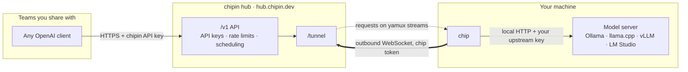
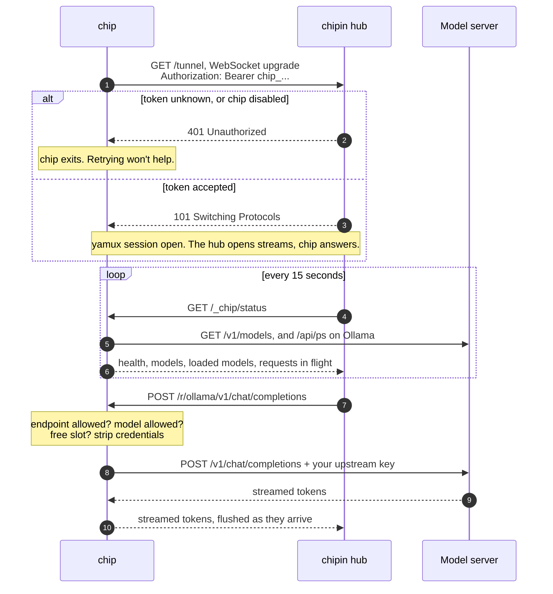

<div align="center">

<pre>
 ██████╗██╗  ██╗██╗██████╗
██╔════╝██║  ██║██║██╔══██╗
██║     ███████║██║██████╔╝
██║     ██╔══██║██║██╔═══╝
╚██████╗██║  ██║██║██║
 ╚═════╝╚═╝  ╚═╝╚═╝╚═╝
</pre>

**Share the model server on your machine with the people who need it.**<br>
No open ports. No exposed address. Your keys stay on your machine.

[chipin.dev](https://chipin.dev) · [Whitepaper](https://chipin.dev/whitepaper) · [Hub](https://hub.chipin.dev)


</div>

---

chip is the agent half of [chipin](https://chipin.dev). You run it next to Ollama, llama.cpp, vLLM, LM Studio or any other OpenAI-compatible server. It dials out to the chipin hub at **hub.chipin.dev** and keeps that connection open. The hub sends requests down it from the teams you share with, and chip passes them to your model server.

```sh
chip -server https://hub.chipin.dev -token chip_... -upstream http://127.0.0.1:11434/v1
```

That's the whole setup: one static binary with two dependencies, and no config file needed.

## Contents

- [How it connects](#how-it-connects)
- [Quick start](#quick-start)
- [Authentication](#authentication)
- [Configuration](#configuration)
- [What chip allows](#what-chip-allows)
- [What the hub learns about your machine](#what-the-hub-learns-about-your-machine)
- [Running as a service](#running-as-a-service)
- [Logs and troubleshooting](#logs-and-troubleshooting)
- [Building](#building)

## How it connects



chip makes exactly one connection, and it goes outward. It's a WebSocket to `hub.chipin.dev/tunnel` with [yamux](https://github.com/hashicorp/yamux) running on top. The hub opens a new stream for each request, and chip serves plain HTTP on each stream. One connection carries any number of concurrent requests, and it works behind NAT, home routers and most firewalls.

The full life of a connection:



If the connection drops, chip reconnects after 1 second, then 2, 4 and so on, up to once a minute. The wait resets to 1 second after each successful connection.

## Quick start

1. **Register the chip.** Sign in at [hub.chipin.dev](https://hub.chipin.dev), open **Chips**, choose **Add chip** and copy the token. It's shown once.
2. **Build chip.** See [Building](#building).
3. **Run it** on the machine with your model server:

   ```sh
   export CHIP_TOKEN=chip_...
   chip -server https://hub.chipin.dev -upstream http://127.0.0.1:11434/v1 -name ollama
   ```

   ```
   level=INFO msg="connected to chipin" server=https://hub.chipin.dev resources=1
   ```

4. **Share it.** Your own organization's API keys can use the chip straight away. To share it with another team, open the chip's **Chip in** dialog, enter their chipin code and set a weight. The chip starts serving them once their admin approves you.

The upstream URL is the base of the OpenAI API, including `/v1`:

| Server | Upstream |
|---|---|
| Ollama | `http://127.0.0.1:11434/v1` |
| llama.cpp (`llama-server`) | `http://127.0.0.1:8080/v1` |
| vLLM | `http://127.0.0.1:8000/v1` |
| LM Studio | `http://127.0.0.1:1234/v1` |

## Authentication

There are three credentials in play, and each one stops at a boundary.

| Credential | Who holds it | Where it goes | Where it stops |
|---|---|---|---|
| **Chip token** `chip_...` | You | From chip to the hub, once per connection | At the hub. Your model server never sees it. |
| **chipin API key** `sk-chipin-...` | The teams you share with | From their client to the hub | At the hub. chip strips `Authorization` from every request. |
| **Upstream key** | You (optional) | From chip to your model server | On your machine. It never crosses the tunnel. |

### The chip token

The chip token identifies this chip to the hub.

- It is `chip_` followed by 32 random URL-safe characters (24 bytes). The hub shows it once and stores only its SHA-256 hash.
- chip sends it as `Authorization: Bearer chip_...` on the WebSocket upgrade to `/tunnel`, along with an `X-Chipin-Chip-Version` header. Use an `https://` server URL so this happens over TLS. chip logs a warning if you point it at plain `http` on anything other than localhost.
- If the hub answers `401`, chip stops with `chip token rejected by server` instead of retrying. That means the token is wrong, or the chip has been disabled or deleted.
- **Disabling** the chip in the dashboard refuses new connections. **Deleting** it revokes the token for good.
- A chip has one live connection. If a second process connects with the same token, the hub drops the first one.

You can supply the token three ways. Flags override the environment, and both override the config file:

```sh
chip -token chip_...            # visible to other users in `ps`. Avoid on shared machines.
CHIP_TOKEN=chip_... chip ...    # better
chip -config chip.json          # "token": "chip_..." in a file only you can read
```

### Your upstream key

Your upstream key is for model servers that require one, such as `llama-server --api-key` or a hosted provider. chip removes whatever `Authorization` header arrived over the tunnel and sets `Authorization: Bearer <your key>` before forwarding. To keep the key out of files, use `api_key_env` to name an environment variable, and chip reads the key from it at startup.

## Configuration

chip can be configured with flags only, a JSON file only, or both.

### Flags

| Flag | Default | Description |
|---|---|---|
| `-server` | | Hub URL, e.g. `https://hub.chipin.dev`. Overrides the config file. |
| `-token` | `$CHIP_TOKEN` | Chip token. Overrides the config file. |
| `-config` | | Path to a JSON config file. |
| `-upstream` | | Share one OpenAI-compatible API at this base URL. Adds to any resources in the config file. |
| `-name` | `ai` | Resource name for `-upstream`. |
| `-api-key-env` | | Environment variable holding the upstream key for `-upstream`. |
| `-max-concurrent` | `2` | How many requests `-upstream` runs at once. |
| `-version` | | Print the version and exit. |

### Config file

Use a file to share more than one model server, to limit which models are shared, or to keep the token out of your shell history.

```json
{
  "server": "https://hub.chipin.dev",
  "token": "chip_paste_token_from_dashboard",
  "resources": [
    {
      "name": "ollama",
      "upstream": "http://127.0.0.1:11434/v1",
      "max_concurrent": 2
    },
    {
      "name": "qwen",
      "upstream": "http://127.0.0.1:4330/v1",
      "api_key_env": "LLAMA_API_KEY",
      "max_concurrent": 1
    },
    {
      "name": "vllm",
      "upstream": "http://127.0.0.1:8000/v1",
      "api_key_env": "VLLM_API_KEY",
      "models": ["meta-llama/Llama-3.1-8B-Instruct"]
    }
  ]
}
```

```sh
chip -config chip.json
```

| Field | Required | Default | Description |
|---|---|---|---|
| `server` | yes | | Hub URL. |
| `token` | yes | | Chip token. Can come from `-token` or `CHIP_TOKEN` instead. |
| `resources` | yes | | One or more model servers to share. |
| `resources[].name` | yes | | Letters, digits, `-` and `_`, up to 64 characters. Unique within the chip. |
| `resources[].upstream` | yes | | `http` or `https` base URL including `/v1`. |
| `resources[].kind` | | `openai` | Resource type. `openai` is the only kind today. |
| `resources[].api_key` | | | Key added to upstream requests. Prefer `api_key_env`. |
| `resources[].api_key_env` | | | Environment variable holding the key. chip refuses to start if it's empty. |
| `resources[].models` | | all | Allowlist of model names. Others are refused and left out of the status report. |
| `resources[].max_concurrent` | | `2` | How many requests this resource runs at once. Match your server's parallel slots, e.g. `llama-server -np`. |

chip checks the whole config at startup and exits with a clear message if anything is wrong.

### Settings on the hub

Some settings control how your chip is shared, not what it can reach. You set those per chip in the dashboard at [hub.chipin.dev](https://hub.chipin.dev), in the chip's **Chip in** dialog:

| Setting | Effect |
|---|---|
| **Weights** | The teams this chip serves, and your own organization, each with a weight from 0 to 1000. Weights set each one's share of the chip when they compete for it. |
| **Your requests go first** | Your organization's requests take the next free slot ahead of everyone else's. |
| **Speed tests** | Lets the hub send a short test prompt about once an hour to measure speed. It does this only when the chip is idle and the model is already loaded. |
| **Apply to all your chips** | Copies these settings to every chip you own. |

**Disable** on the Chips page turns a chip off without deleting it.

## What chip allows

chip is the boundary between the hub and your machine. It decides what gets through, and the hub can't override it.

- **Four endpoints.** `POST /v1/chat/completions`, `POST /v1/completions`, `POST /v1/embeddings` and `GET /v1/models`. Everything else gets a `404`, including Ollama's `/api/pull` and `/api/delete`.
- **Your upstreams only.** Requests go to the URLs in your config. The hub picks a resource by name and can't supply an address.
- **Your models only.** With `models` set, requests for anything else get a `404`.
- **Your concurrency limit.** When every slot is busy, chip answers `429` itself. The hub schedules around this, so you won't normally see it.
- **No credentials pass through.** chip removes `Authorization`, `Cookie`, `Forwarded` and the `X-Forwarded-*` headers before your model server sees the request.
- **Bounded requests.** Request bodies over 32 MB are refused.
- **Streaming.** Tokens are passed to the hub as soon as your server produces them.

**A word on trust.** You can see the prompts and responses that pass through your machine, and the teams you share with are trusting you with them. chipin tells them so.

## What the hub learns about your machine

The hub needs a little information to route requests well. Every 15 seconds chip reports:

- the chip version, operating system, CPU architecture and CPU count
- for each resource:
  - its name and whether it's healthy
  - the models it serves, and which are loaded in memory (Ollama only)
  - its slot count and how many requests are running
  - how long `/v1/models` took to answer

The hub also sees the public IP address your connection comes from, as any server does.

The teams you share with see none of this. They see your organization's name and the models on offer, never your machine's name, address or configuration.

## Running as a service

<details>
<summary><b>Linux (systemd user service)</b></summary>

`~/.config/chip/env`, readable only by you (`chmod 600`):

```sh
CHIP_TOKEN=chip_...
```

`~/.config/systemd/user/chip.service`:

```ini
[Unit]
Description=chip, sharing a local model server with chipin
After=network-online.target

[Service]
EnvironmentFile=%h/.config/chip/env
ExecStart=%h/.local/bin/chip -server https://hub.chipin.dev -upstream http://127.0.0.1:11434/v1 -name ollama
Restart=always
RestartSec=5

[Install]
WantedBy=default.target
```

```sh
systemctl --user daemon-reload
systemctl --user enable --now chip
loginctl enable-linger "$USER"   # keep running after you log out
journalctl --user -u chip -f
```

If your upstream key is in a file, read it at startup so it stays out of the unit:

```ini
ExecStart=/bin/sh -c 'LLAMA_API_KEY="$$(cat %h/.config/llama/api-key)" exec %h/.local/bin/chip -server https://hub.chipin.dev -upstream http://127.0.0.1:4330/v1 -name qwen -api-key-env LLAMA_API_KEY -max-concurrent 1'
```

</details>

<details>
<summary><b>macOS (launchd)</b></summary>

`~/Library/LaunchAgents/dev.chipin.chip.plist`:

```xml
<?xml version="1.0" encoding="UTF-8"?>
<!DOCTYPE plist PUBLIC "-//Apple//DTD PLIST 1.0//EN" "http://www.apple.com/DTDs/PropertyList-1.0.dtd">
<plist version="1.0">
<dict>
  <key>Label</key><string>dev.chipin.chip</string>
  <key>ProgramArguments</key>
  <array>
    <string>/usr/local/bin/chip</string>
    <string>-config</string>
    <string>/Users/you/.config/chip/chip.json</string>
  </array>
  <key>RunAtLoad</key><true/>
  <key>KeepAlive</key><true/>
  <key>StandardErrorPath</key><string>/Users/you/Library/Logs/chip.log</string>
</dict>
</plist>
```

```sh
launchctl bootstrap gui/$(id -u) ~/Library/LaunchAgents/dev.chipin.chip.plist
tail -f ~/Library/Logs/chip.log
```

</details>

<details>
<summary><b>Windows</b></summary>

chip runs in a console window and stops cleanly on Ctrl+C:

```powershell
$env:CHIP_TOKEN = "chip_..."
.\chip-windows-amd64.exe -server https://hub.chipin.dev -upstream http://127.0.0.1:11434/v1 -name ollama
```

chip can't install itself as a Windows service yet. To keep it running after you log out, start it from Task Scheduler at log-on, or wrap it with a service manager such as NSSM.

</details>

## Logs and troubleshooting

chip logs to stderr in `key=value` form.

| Message | Meaning |
|---|---|
| `connected to chipin` | The tunnel is up and the hub can send requests. |
| `disconnected from chipin, reconnecting` | The connection dropped, often because the hub restarted. chip reconnects on its own. |
| `cannot reach server, retrying` | The hub is unreachable. chip retries, waiting up to a minute between attempts. |
| `chip token rejected by server` | The token is wrong, or the chip was disabled or deleted. chip exits. |
| `server URL is not https` | Your token and traffic would cross the network unencrypted. Use `https://`. |
| `upstream error` | Your model server didn't answer a request. Is it running? |
| `env var X is empty` | `api_key_env` names a variable that isn't set where chip runs. |
| `resource name "..." must match ...` | Names may use letters, digits, `-` and `_` only. |

The Chips page in the dashboard shows each chip's state:

| Status | Meaning |
|---|---|
| **Online** | Connected, and every model server is answering. |
| **Degraded** | Connected, but chip can't reach at least one model server. Try `curl <upstream>/models` on the same machine. |
| **Unreachable** | Connected, but the hub's status checks to chip are failing. |
| **Offline** | chip isn't connected. Check its logs. |
| **Disabled** | Turned off in the dashboard. chip's token is refused until you enable it again. |

## Building

chip needs Go 1.26. It builds with CGO off, so the binaries are fully static.

```sh
make build    # ./bin/chip for this machine
make test     # run the tests
make dist     # cross-compile into ./dist
```

`make dist` produces:

| File | Platform |
|---|---|
| `chip-darwin-arm64` | macOS, Apple Silicon |
| `chip-darwin-amd64` | macOS, Intel |
| `chip-linux-amd64` | Linux, x86-64 |
| `chip-linux-arm64` | Linux, ARM64 (Raspberry Pi 4/5, Graviton, Jetson) |
| `chip-windows-amd64.exe` | Windows, x86-64 |

### Layout

```
cmd/chip/    the binary: flags and startup
chip.go      the agent: tunnel loop, endpoint allowlist, upstream proxy, status
config.go    config file format and validation
tunnel/      WebSocket + yamux transport, shared with the chipin hub
proto/       paths and types shared with the chipin hub
```

`tunnel` and `proto` hold the whole protocol between chip and the hub. To see exactly what crosses the wire, read those two packages.

<div align="center">
<br>
<a href="https://chipin.dev"><b>chipin.dev</b></a>
</div>
