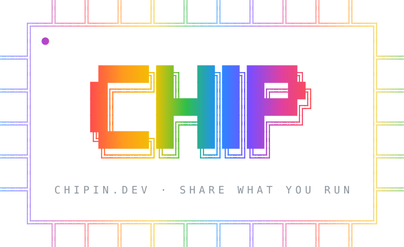
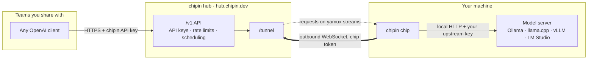
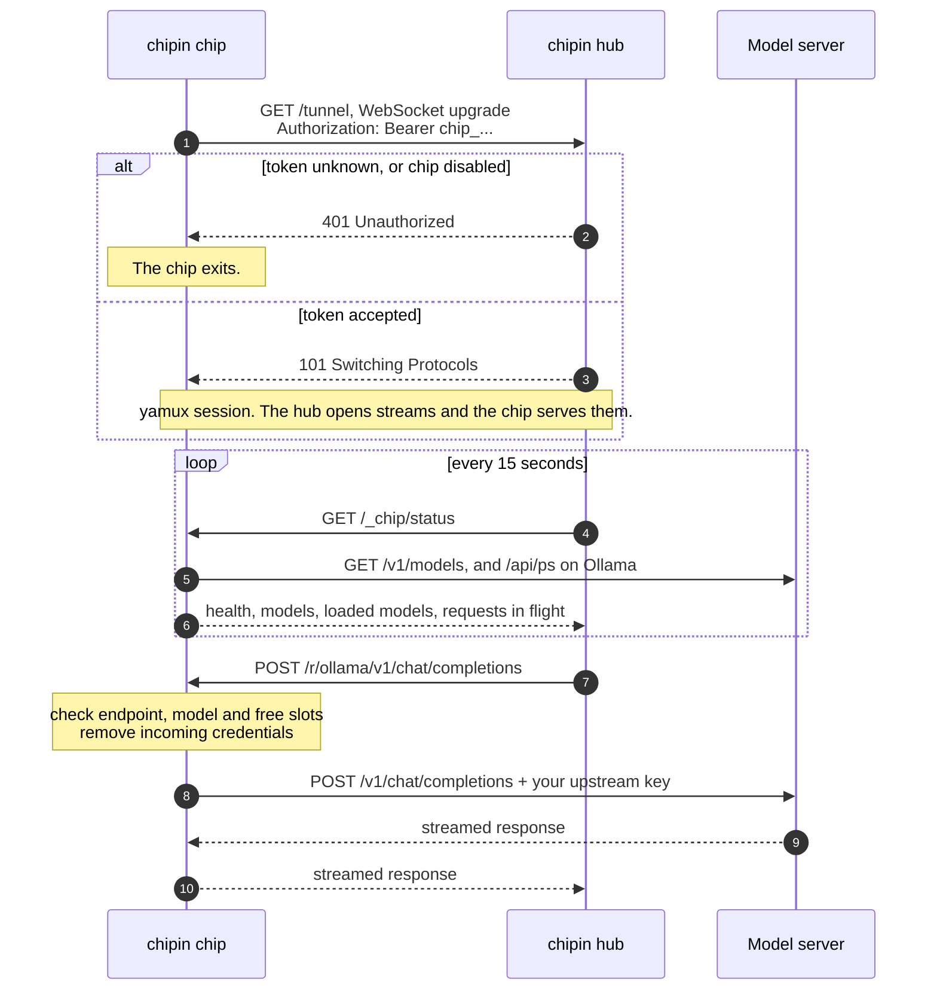

<div align="center">



[chipin.dev](https://chipin.dev) · [Whitepaper](https://chipin.dev/whitepaper) · [Hub](https://hub.chipin.dev)


</div>

The chipin chip is the agent for [chipin](https://chipin.dev). It runs on a machine with a model server, such as Ollama, llama.cpp, vLLM or LM Studio, and connects to the chipin hub at hub.chipin.dev. The hub sends requests from the teams you share with over that connection, and the chip forwards them to the model server.

The chip only makes outbound connections, so you don't need to open ports or publish the machine's address. If the model server needs an API key, the chip adds it locally, and the key is never sent to the hub.

```sh
chip -server https://hub.chipin.dev -token chip_... -upstream http://127.0.0.1:11434/v1
```

## How it connects



The chip opens a WebSocket to `https://hub.chipin.dev/tunnel` and runs [yamux](https://github.com/hashicorp/yamux) over it. The hub opens one yamux stream per request, and the chip serves HTTP on each stream, so one connection carries many requests at once. This works behind NAT and most firewalls.

This sequence shows the connection, the regular status checks, and one request:



If the connection drops, the chip waits 1 second and tries again. Each failed attempt doubles the wait, up to 1 minute. After a successful connection the wait goes back to 1 second.

## Quick start

1. Sign in at [hub.chipin.dev](https://hub.chipin.dev), open **Chips**, choose **Add chip** and copy the token. The token is shown only once.
2. Build the chip. See [Building](#building).
3. Run it on the machine with the model server:

   ```sh
   export CHIP_TOKEN=chip_...
   chip -server https://hub.chipin.dev -upstream http://127.0.0.1:11434/v1 -name ollama
   ```

   When it connects, it logs:

   ```
   level=INFO msg="connected to chipin" server=https://hub.chipin.dev resources=1
   ```

4. API keys in your own organization can use the chip right away. To share it with another team, open the chip's **Chip in** dialog, enter the team's chipin code and set a weight. The chip starts serving that team after one of its admins approves your organization.

The upstream is the base URL of the model server's OpenAI-compatible API, including `/v1`. The usual defaults are:

| Model server | Upstream |
|---|---|
| Ollama | `http://127.0.0.1:11434/v1` |
| llama.cpp (`llama-server`) | `http://127.0.0.1:8080/v1` |
| vLLM | `http://127.0.0.1:8000/v1` |
| LM Studio | `http://127.0.0.1:1234/v1` |

## Authentication

Three kinds of credentials are involved:

| Credential | Belongs to | Sent from | Sent to |
|---|---|---|---|
| Chip token (`chip_...`) | You | The chip | The hub, when the chip connects |
| chipin API key (`sk-chipin-...`) | The teams you share with | Their client | The hub. The chip removes it before forwarding. |
| Upstream key (optional) | You | The chip | Your model server |

### Chip token

The hub creates the token when you register the chip. It is `chip_` followed by 32 URL-safe characters (24 random bytes). The hub shows it once and stores only a SHA-256 hash of it.

The chip sends the token in an `Authorization: Bearer` header when it opens the WebSocket, and its version in an `X-Chipin-Chip-Version` header. Use an `https://` server URL so the token is sent over TLS. The chip logs a warning if the server URL uses plain `http` and isn't localhost.

If the hub answers with 401, the chip logs `chip token rejected by server` and exits instead of retrying. This means the token is wrong, or the chip has been disabled or deleted in the dashboard. A disabled chip's token is refused until you enable the chip again. Deleting a chip revokes its token permanently.

Each chip has one connection at a time. If a second process connects with the same token, the hub closes the first connection.

The token can come from the `-token` flag, the `CHIP_TOKEN` environment variable or the config file. The flag overrides the environment variable, and both override the file. On a shared machine, don't use `-token`, because other users can see command-line arguments with `ps`.

```sh
CHIP_TOKEN=chip_... chip -server https://hub.chipin.dev -upstream http://127.0.0.1:11434/v1
```

### Upstream key

If your model server requires an API key, for example `llama-server --api-key`, the chip adds it to each request. Before forwarding, the chip removes the `Authorization` header that came from the hub and sets `Authorization: Bearer <your key>`. You can put the key in the config file as `api_key`. To keep it out of the file, use `api_key_env` to name an environment variable that holds it.

## Configuration

The chip can be configured with flags, a JSON config file, or both.

### Flags

| Flag | Default | Description |
|---|---|---|
| `-server` | | Hub URL, for example `https://hub.chipin.dev`. Overrides the config file. |
| `-token` | `$CHIP_TOKEN` | Chip token. Overrides the config file. |
| `-config` | | Path to a JSON config file. |
| `-upstream` | | Base URL of one OpenAI-compatible API to share. Added to any resources in the config file. |
| `-name` | `ai` | Resource name for `-upstream`. |
| `-api-key-env` | | Environment variable that holds the upstream key for `-upstream`. |
| `-max-concurrent` | `2` | Number of requests `-upstream` runs at once. |
| `-version` | | Print the version and exit. |

### Config file

Use a config file to share more than one model server or to limit which models are shared.

```json
{
  "server": "https://hub.chipin.dev",
  "token": "chip_paste_token_from_dashboard",
  "resources": [
    {
      "name": "ollama",
      "upstream": "http://127.0.0.1:11434/v1",
      "max_concurrent": 2
    },
    {
      "name": "qwen",
      "upstream": "http://127.0.0.1:4330/v1",
      "api_key_env": "LLAMA_API_KEY",
      "max_concurrent": 1
    },
    {
      "name": "vllm",
      "upstream": "http://127.0.0.1:8000/v1",
      "api_key_env": "VLLM_API_KEY",
      "models": ["meta-llama/Llama-3.1-8B-Instruct"]
    }
  ]
}
```

```sh
chip -config chip.json
```

| Field | Required | Default | Description |
|---|---|---|---|
| `server` | Yes | | Hub URL. |
| `token` | Yes | | Chip token. Can be given with `-token` or `CHIP_TOKEN` instead. |
| `resources` | Yes | | The model servers to share. |
| `resources[].name` | Yes | | Up to 64 letters, digits, `-` or `_`. Must be unique within the chip. |
| `resources[].upstream` | Yes | | `http` or `https` base URL, including `/v1`. |
| `resources[].kind` | | `openai` | Resource type. `openai` is the only supported type. |
| `resources[].api_key` | | | Key added to upstream requests. |
| `resources[].api_key_env` | | | Environment variable that holds the key. The chip won't start if the variable is empty. |
| `resources[].models` | | All | Models that may be used. Requests for other models are refused, and the other models aren't reported to the hub. |
| `resources[].max_concurrent` | | `2` | Number of requests this resource runs at once. Set it to the number of parallel slots your server has, such as `llama-server -np`. |

The chip checks the configuration when it starts and exits with an error message if something is wrong.

### Settings in the dashboard

Sharing settings are stored on the hub. You set them for each chip in its **Chip in** dialog at [hub.chipin.dev](https://hub.chipin.dev).

| Setting | Effect |
|---|---|
| Weights | Each team the chip serves, and your own organization, has a weight from 0 to 1000. When they compete for the chip, the weights set each one's share. |
| Your requests go first | Requests from your organization get the next free slot before anyone else's. |
| Speed tests | Allows the hub to send a short test prompt about once an hour to measure speed. Tests are only sent when the chip is idle and the model is already loaded. |
| Apply to all your chips | Copies these settings to every chip you own. |

The **Disable** button on the Chips page turns a chip off without deleting it.

## Request handling

The chip checks each request from the hub before forwarding it. These checks run on your machine, and the hub can't change them.

- Only `POST /v1/chat/completions`, `POST /v1/completions`, `POST /v1/embeddings` and `GET /v1/models` are forwarded. Other paths return 404, so Ollama endpoints such as `/api/pull` and `/api/delete` can't be reached.
- Requests only go to the upstream URLs in the chip's configuration. The hub chooses a resource by name and can't supply an address.
- If `models` is set, requests for any other model return 404.
- If all of a resource's slots are in use, the chip returns 429. The hub normally avoids sending requests to a full chip.
- The `Authorization`, `Cookie`, `Forwarded`, `X-Forwarded-For`, `X-Forwarded-Host` and `X-Forwarded-Proto` headers are removed.
- Request bodies larger than 32 MB are rejected.
- Streamed responses are passed back to the hub as they arrive.

The owner of a chip can read the prompts and responses that pass through it. chipin tells teams this when they use shared chips.

## Data sent to the hub

The hub asks for the chip's status every 15 seconds. The chip reports its version, operating system, CPU architecture and CPU count. For each resource it reports:

- the name, and whether the model server answered
- the models it serves, and which of them are loaded in memory (Ollama only)
- the number of slots and the number of requests running
- how long the model server took to answer `/v1/models`

The hub also sees the IP address that the connection comes from.

Teams that use your chip see your organization's name and the models it serves. They don't see the machine's name, address or configuration.

## Running as a service

<details>
<summary>Linux (systemd user service)</summary>

Put the token in `~/.config/chip/env` and make the file readable only by you with `chmod 600`:

```sh
CHIP_TOKEN=chip_...
```

Create `~/.config/systemd/user/chip.service`:

```ini
[Unit]
Description=chipin chip
After=network-online.target

[Service]
EnvironmentFile=%h/.config/chip/env
ExecStart=%h/.local/bin/chip -server https://hub.chipin.dev -upstream http://127.0.0.1:11434/v1 -name ollama
Restart=always
RestartSec=5

[Install]
WantedBy=default.target
```

Start it, and allow it to keep running after you log out:

```sh
systemctl --user daemon-reload
systemctl --user enable --now chip
loginctl enable-linger "$USER"
journalctl --user -u chip -f
```

If the upstream key is stored in a file, the service can read it at startup so the key isn't written in the unit file:

```ini
ExecStart=/bin/sh -c 'LLAMA_API_KEY="$$(cat %h/.config/llama/api-key)" exec %h/.local/bin/chip -server https://hub.chipin.dev -upstream http://127.0.0.1:4330/v1 -name qwen -api-key-env LLAMA_API_KEY -max-concurrent 1'
```

</details>

<details>
<summary>macOS (launchd)</summary>

Create `~/Library/LaunchAgents/dev.chipin.chip.plist`:

```xml
<?xml version="1.0" encoding="UTF-8"?>
<!DOCTYPE plist PUBLIC "-//Apple//DTD PLIST 1.0//EN" "http://www.apple.com/DTDs/PropertyList-1.0.dtd">
<plist version="1.0">
<dict>
  <key>Label</key><string>dev.chipin.chip</string>
  <key>ProgramArguments</key>
  <array>
    <string>/usr/local/bin/chip</string>
    <string>-config</string>
    <string>/Users/you/.config/chip/chip.json</string>
  </array>
  <key>RunAtLoad</key><true/>
  <key>KeepAlive</key><true/>
  <key>StandardErrorPath</key><string>/Users/you/Library/Logs/chip.log</string>
</dict>
</plist>
```

Load it and follow the log:

```sh
launchctl bootstrap gui/$(id -u) ~/Library/LaunchAgents/dev.chipin.chip.plist
tail -f ~/Library/Logs/chip.log
```

</details>

<details>
<summary>Windows</summary>

The chip runs in a console window. Press Ctrl+C to stop it.

```powershell
$env:CHIP_TOKEN = "chip_..."
.\chip-windows-amd64.exe -server https://hub.chipin.dev -upstream http://127.0.0.1:11434/v1 -name ollama
```

The chip can't install itself as a Windows service yet. To keep it running after you log out, start it with Task Scheduler at log-on, or run it under a service manager such as NSSM.

</details>

## Logs and troubleshooting

The chip writes its log to stderr in `key=value` format.

| Message | Meaning |
|---|---|
| `connected to chipin` | The connection to the hub is open. |
| `disconnected from chipin, reconnecting` | The connection closed, usually because the hub restarted. The chip reconnects automatically. |
| `cannot reach server, retrying` | The chip can't reach the hub. It keeps trying, with up to a minute between attempts. |
| `chip token rejected by server` | The token is wrong, or the chip was disabled or deleted. The chip exits. |
| `server URL is not https` | The token and requests would be sent unencrypted. Use an `https://` URL. |
| `upstream error` | The model server didn't respond to a request. Check that it's running. |
| `env var X is empty` | The variable named in `api_key_env` isn't set in the chip's environment. |
| `resource name "..." must match ...` | Resource names can only contain letters, digits, `-` and `_`. |

The Chips page in the dashboard shows each chip's status:

| Status | Meaning |
|---|---|
| Online | Connected, and every model server is answering. |
| Degraded | Connected, but at least one model server isn't answering. Run `curl <upstream>/models` on the same machine to check it. |
| Unreachable | Connected, but the hub's status checks are failing. |
| Offline | Not connected. Check the chip's log. |
| Disabled | Turned off in the dashboard. The token is refused until the chip is enabled again. |

## Building

Building requires Go 1.26. Binaries are built with CGO disabled, so they're statically linked.

```sh
make build    # ./bin/chip for this machine
make test     # run the tests
make dist     # cross-compile into ./dist
```

`make dist` builds:

| File | Platform |
|---|---|
| `chip-darwin-arm64` | macOS on Apple Silicon |
| `chip-darwin-amd64` | macOS on Intel |
| `chip-linux-amd64` | Linux on x86-64 |
| `chip-linux-arm64` | Linux on ARM64, such as Raspberry Pi 4 and 5 |
| `chip-windows-amd64.exe` | Windows on x86-64 |

### Layout

```
cmd/chip/    command-line flags and startup
chip.go      connection loop, request checks, upstream proxy, status
config.go    config file format and validation
tunnel/      WebSocket and yamux transport, also used by the hub
proto/       paths and types shared with the hub
```

The `tunnel` and `proto` packages contain the protocol between the chip and the hub.

## License

Copyright 2026 Jeff Webb. Licensed under the [Apache License, Version 2.0](LICENSE).

If you redistribute the chip or a modified version of it, include the [LICENSE](LICENSE) and [NOTICE](NOTICE) files. The license doesn't grant rights to the chipin name or logo.

Binaries also include third-party software: yamux (MPL-2.0), coder/websocket (ISC) and the Go standard library (BSD-3-Clause). Their licenses are in [THIRD_PARTY_NOTICES](THIRD_PARTY_NOTICES).
